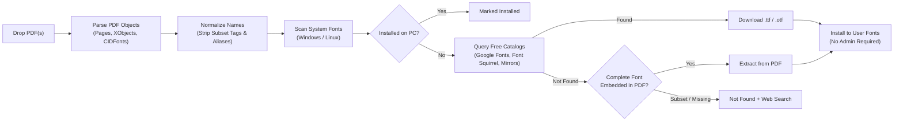

<div align="center">
  

  <h1>PDF Fonts Detector</h1>

  <p>
    <strong>Inspect every font inside any PDF, check what is already installed on your PC, and download, extract, or install missing fonts in one click.</strong>
  </p>

  <p>
    <a href="https://github.com/furcy75/PDF_Fonts_Detector/releases/latest">
      
    </a>
    <a href="https://github.com/furcy75/PDF_Fonts_Detector/actions/workflows/build.yml">
      
    </a>
    
    
    <a href="LICENSE">
      
    </a>
  </p>

  <p>
    <a href="#download">Download</a> •
    <a href="#key-features">Features</a> •
    <a href="#how-it-works">How It Works</a> •
    <a href="#multilingual-support">Languages</a> •
    <a href="#building-from-source">Build from Source</a>
  </p>
</div>

---

## Overview

**PDF Fonts Detector** is a fast, native, **100% standalone desktop application** written in Rust (`egui` / `eframe`) for **Windows** and **Linux**.

Opening a PDF in a design tool, office suite, or publishing workflow often fails or breaks layout when fonts are missing on the local machine. PDF Fonts Detector eliminates the manual detective work: drop one or more PDF files onto the window, immediately see which fonts are installed vs. missing, fetch free fonts automatically from official catalogs, extract complete embedded fonts directly from the PDF when available, and install them without administrator privileges.

---

## Key Features

| Feature | Description |
| :--- | :--- |
| **100% Standalone Executables** | Single native binary (~7–12 MB) with instant startup. **Zero runtime dependencies**: no Python, no Qt, no Electron/WebView, no OpenSSL, and no GTK3 required. |
| **Deep PDF Font Inspection** | Recursively parses pages, inherited `/Resources`, Type0/CID `/DescendantFonts`, and nested Form `/XObject` streams. Strips subset tags (`ABCDEF+Roboto-Bold` → `Roboto Bold`) and resolves PostScript/Microsoft aliases (`ArialMT`, `TimesNewRomanPSMT`, `Calibri,BoldItalic`). |
| **Accurate Local PC Verification** | Reads internal OpenType/TrueType `name` tables (`ttf-parser`) across **Windows** (`C:\Windows\Fonts`, `%LOCALAPPDATA%\Microsoft\Windows\Fonts`, and Registry) and **Linux** (`fc-list`, `/usr/share/fonts`, `/usr/local/share/fonts`, `~/.local/share/fonts`). Distinguishes exact style matches from family-only matches. |
| **Zero-Config Free Font Downloads** | Automatically queries **Google Fonts** (official `.ttf` ZIP archives + CSS2 fallback), **Font Squirrel**, and curated **open-source mirrors** (Liberation, DejaVu, Cascadia Code/Mono). No API keys required. |
| **Complete Embedded Font Extraction** | For fonts unavailable in free catalogs, inspects the embedded binary stream (`ttf-parser` glyph count & alphabet coverage) and enables **"Extract from PDF"** whenever a complete, non-subsetted `.ttf`/`.otf` font is embedded. |
| **One-Click No-Admin Installation** | Installs fonts into the current user session: **Windows** (`%LOCALAPPDATA%\Microsoft\Windows\Fonts` + `HKCU` registry + live `WM_FONTCHANGE` broadcast) and **Linux** (`~/.local/share/fonts/PDF_Fonts_Detector` + `fc-cache -f`). |
| **15 Languages Built In** | Automatically detects your OS language on startup and allows live switching from the header bar with persistent preferences. |

---

## Download

Pre-built standalone binaries are published automatically via GitHub Actions on every release:

👉 **[Download Latest Release](https://github.com/furcy75/PDF_Fonts_Detector/releases/latest)**

### Windows (x64)
1. Download **`PDF-Fonts-Detector-Windows-x64.exe`**.
2. Double-click to run — no installer or runtime needed.

### Linux (x86_64)
Compiled on Ubuntu 22.04 (`glibc 2.35`, linking only against `libc`, `libm`, and `libgcc_s`) with pure-Rust TLS (`rustls`) and XDG Desktop Portal file dialogs (`rfd`):

- **Direct standalone binary**:
  ```bash
  chmod +x PDF-Fonts-Detector-Linux-x86_64
  ./PDF-Fonts-Detector-Linux-x86_64
  ```
- **Portable archive with desktop shortcut & icon** (`PDF-Fonts-Detector-Linux-x86_64.tar.gz`):
  ```bash
  tar -xzf PDF-Fonts-Detector-Linux-x86_64.tar.gz
  cd PDF-Fonts-Detector-Linux-x86_64
  ./install-desktop-shortcut.sh   # Optional: adds app launcher & icon to your desktop menu
  ./pdf-fonts-detector
  ```

> **Tip:** You can also pass PDF file paths directly on the command line (or associate the app via *"Open With"*):
> ```bash
> pdf-fonts-detector document.pdf
> ```

---

## How It Works



### About Commercial & Subsetted PDF Fonts

- **Commercial / proprietary fonts** (e.g., *Helvetica Neue*, *Futura*, *Gotham*, *Adobe Fonts*) cannot be legally downloaded from free repositories. PDF Fonts Detector clearly marks them as **Not found** and provides a one-click web search button.
- **Subsets vs. Complete embedded fonts**: Most PDF generators embed only a *subset* of glyphs actually used in the document (identified by a 6-letter `ABCDEF+` tag or incomplete character maps). PDF Fonts Detector verifies glyph coverage via `ttf-parser` and only unlocks **Extract from PDF** when a complete, usable TrueType/OpenType font is embedded.

---

## Multilingual Support

PDF Fonts Detector automatically detects your operating system locale and lets you switch languages live at any time from the top-right selector. Supported languages (**15**):

| | | | | |
| :--- | :--- | :--- | :--- | :--- |
| **English** (`en`) | **Français** (`fr`) | **Español** (`es`) | **Deutsch** (`de`) | **Italiano** (`it`) |
| **Português** (`pt`) | **Nederlands** (`nl`) | **Polski** (`pl`) | **Svenska** (`sv`) | **Dansk** (`da`) |
| **Čeština** (`cs`) | **Română** (`ro`) | **Türkçe** (`tr`) | **Русский** (`ru`) | **Українська** (`uk`) |

Selected language and download folder preferences are saved automatically in your OS user configuration directory (`pdf-fonts-detector/settings.json`).

---

## Building from Source

### Prerequisites

- **Rust** (stable toolchain — install via [rustup.rs](https://rustup.rs/))
- **Linux build headers** (compile-time only; not required at runtime on target machines):
  ```bash
  sudo apt-get update
  sudo apt-get install -y libxkbcommon-dev libwayland-dev libgl1-mesa-dev libx11-dev libxi-dev libxrandr-dev libxcursor-dev
  ```

### Build & Test

```bash
git clone https://github.com/furcy75/PDF_Fonts_Detector.git
cd PDF_Fonts_Detector

# Run unit tests
cargo test

# Build optimized standalone binary
cargo build --release
```

The compiled executable will be located at:
- **Windows**: `target\release\pdf-fonts-detector.exe`
- **Linux**: `target/release/pdf-fonts-detector`

---

## Project Structure

```text
PDF_Fonts_Detector/
├── .github/workflows/
│   ├── ci.yml                 # Automated unit tests on Windows & Linux
│   └── build.yml              # Standalone binary builds & automated GitHub Releases
├── assets/
│   ├── app_icon.svg           # Vector application logo
│   ├── app_icon.png           # 256×256 PNG icon (embedded in GUI & Linux desktop entry)
│   ├── app_icon.ico           # Multi-resolution Windows icon (embedded via build.rs)
│   └── generate_icons.py      # Reproducible zero-dependency icon generator
├── src/
│   ├── main.rs                # Entrypoint, embedded window icon & CLI file handling
│   ├── ui.rs                  # Native egui/eframe dark-slate interface & async workers
│   ├── i18n.rs                # 15-language localization & persistent user settings
│   ├── models.rs              # Core domain structs & status enums
│   ├── normalizer.rs          # Subset prefix stripping, PostScript aliases & style parsing
│   ├── pdf_analyzer.rs        # PDF resource/XObject parser, completeness check & extraction
│   ├── system_fonts.rs        # Cross-platform installed font scanner (Windows & Linux)
│   ├── font_catalog.rs        # Multi-source online catalog lookup (no API key required)
│   ├── font_downloader.rs     # ZIP / tar.gz / CSS2 TTF downloader
│   └── font_installer.rs      # User-level font installer (Windows Registry+GDI / Linux fc-cache)
├── build.rs                   # Embeds Windows .ico & version metadata into .exe
├── Cargo.toml
└── LICENSE
```

---

## Contributing

Contributions, bug reports, and new language translations are welcome!

1. Fork the repository and create a feature branch (`git checkout -b feat/my-improvement`).
2. Add or update unit tests and verify with `cargo test`.
3. Open a Pull Request describing your changes.

---

## License

Distributed under the **MIT License**. See [LICENSE](LICENSE) for more information.
