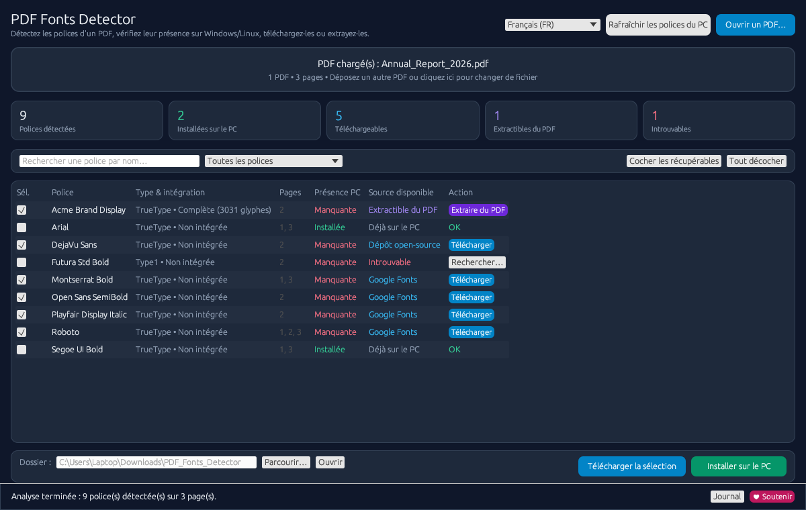

<div align="center">
  <p>
    <a href="../README.md">English</a> ·
    <strong>Français</strong> ·
    <a href="README.es.md">Español</a> ·
    <a href="README.de.md">Deutsch</a> ·
    <a href="README.it.md">Italiano</a> ·
    <a href="README.pt.md">Português</a> ·
    <a href="README.nl.md">Nederlands</a> ·
    <a href="README.pl.md">Polski</a> ·
    <a href="README.ru.md">Русский</a>
  </p>

  

  <h1>PDF Fonts Detector</h1>

  <p>
    <strong>Détectez toutes les polices d'un PDF, vérifiez celles déjà installées sur votre PC, puis téléchargez, extrayez ou installez les polices manquantes en un clic.</strong>
  </p>

  <p>
    <a href="https://github.com/furcy75/PDF_Fonts_Detector/releases/latest">
      
    </a>
    <a href="https://github.com/furcy75/PDF_Fonts_Detector/actions/workflows/build.yml">
      
    </a>
    
    <a href="https://github.com/sponsors/furcy75">
      
    </a>
  </p>
</div>

---

## Présentation

**PDF Fonts Detector** est une application de bureau native, rapide et **100 % autonome**, écrite en Rust (`egui` / `eframe`) pour **Windows** et **Linux**.

Glissez-déposez un ou plusieurs fichiers PDF dans la fenêtre : l'application identifie instantanément toutes les polices utilisées, compare avec les polices installées sur votre ordinateur, télécharge automatiquement les polices libres (Google Fonts, Font Squirrel, dépôts open-source), propose d'extraire les polices complètes intégrées dans le PDF et les installe en un clic sans droits administrateur.

---

## Captures d'écran

<div align="center">
  
  <p><em>Analyse d'un PDF : détection des polices installées, téléchargeables via Google Fonts et polices commerciales introuvables.</em></p>
</div>

---

## Fonctionnalités clés

- **Exécutables 100 % autonomes** : un seul binaire natif (~7–12 Mo), démarrage instantané, sans Python, sans Qt, sans WebView, sans OpenSSL ni GTK3.
- **Analyse PDF approfondie** : pages, `/Resources` hérités, `Type0/CIDFont`, `Form XObjects`, nettoyage des préfixes de sous-ensembles (`ABCDEF+Roboto-Bold` → `Roboto Bold`) et alias PostScript (`ArialMT`, `TimesNewRomanPSMT`, `Calibri,BoldItalic`).
- **Vérification locale précise** : lecture des tables OpenType/TrueType (`ttf-parser`) sur **Windows** (dossiers Fonts + registre) et **Linux** (`fc-list` + dossiers système et utilisateur).
- **Téléchargement gratuit sans clé API** : **Google Fonts** (archives officielles `.ttf` + fallback CSS2), **Font Squirrel** et miroirs open-source (Liberation, DejaVu, Cascadia).
- **Extraction des polices complètes du PDF** : vérifie le nombre de glyphes et la couverture alphabétique ; active **« Extraire du PDF »** uniquement si la police intégrée est complète.
- **Installation sans droits administrateur** : `%LOCALAPPDATA%\Microsoft\Windows\Fonts` + registre `HKCU` + `WM_FONTCHANGE` sur Windows ; `~/.local/share/fonts/PDF_Fonts_Detector` + `fc-cache -f` sur Linux.
- **15 langues intégrées** : détection automatique de la langue système + changement en direct (`EN, FR, ES, DE, IT, PT, NL, PL, SV, DA, CS, RO, TR, RU, UK`).

---

## Téléchargement

👉 **[Télécharger la dernière version](https://github.com/furcy75/PDF_Fonts_Detector/releases/latest)**

- **Windows (x64)** : téléchargez `PDF-Fonts-Detector-Windows-x64.exe` et double-cliquez dessus.
- **Linux (x86_64)** : téléchargez `PDF-Fonts-Detector-Linux-x86_64` (`chmod +x` puis `./PDF-Fonts-Detector-Linux-x86_64`) ou l'archive `PDF-Fonts-Detector-Linux-x86_64.tar.gz` incluant l'icône et `install-desktop-shortcut.sh`.

---

## Compiler depuis les sources

```bash
git clone https://github.com/furcy75/PDF_Fonts_Detector.git
cd PDF_Fonts_Detector
cargo test
cargo build --release
```

---

## Soutenir le projet

Si **PDF Fonts Detector** vous est utile, vous pouvez soutenir son développement via GitHub Sponsors :

<div align="center">
  <a href="https://github.com/sponsors/furcy75">
    
  </a>
</div>

---

## Licence

Distribué sous licence **MIT**. Voir [LICENSE](../LICENSE).
