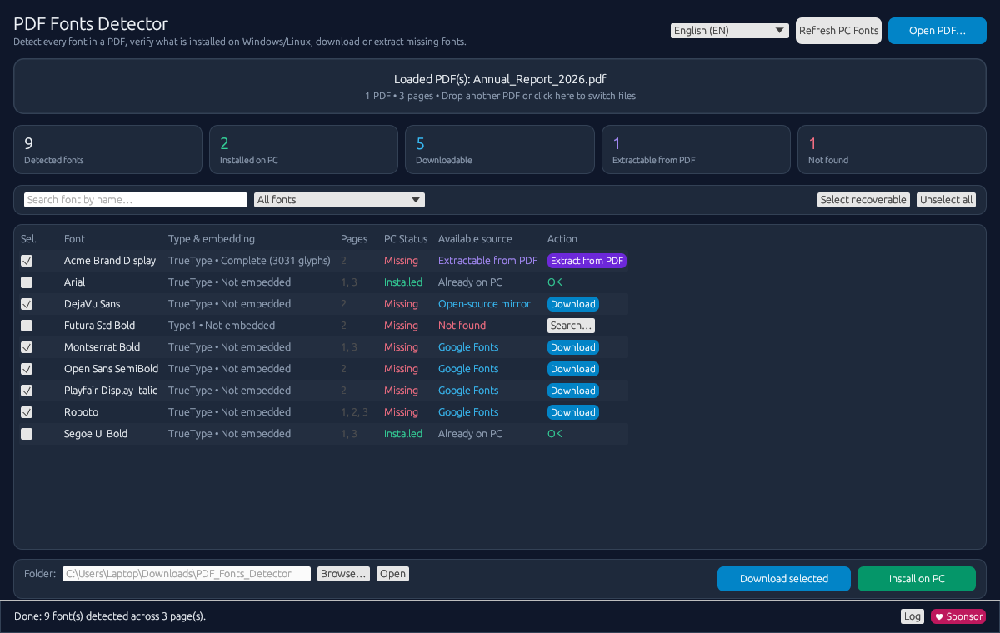

  

    <a href="../README.md">English</a> ·
    <a href="README.fr.md">Français</a> ·
    <a href="README.es.md">Español</a> ·
    <a href="README.de.md">Deutsch</a> ·
    <a href="README.it.md">Italiano</a> ·
    <a href="README.pt.md">Português</a> ·
    <a href="README.nl.md">Nederlands</a> ·
    <strong>Polski</strong> ·
    <a href="README.ru.md">Русский</a>
  

  

  <h1>PDF Fonts Detector</h1>

  

    <strong>Wykryj wszystkie czcionki w dowolnym pliku PDF, sprawdź co jest zainstalowane na komputerze oraz pobierz, wyodrębnij lub zainstaluj brakujące czcionki jednym kliknięciem.</strong>
  

  

    
    
  

---

## Opis

**PDF Fonts Detector** to szybka, natywna i **w 100% samodzielna aplikacja** napisana w języku Rust (`egui` / `eframe`) dla systemów **Windows** i **Linux**. Przeciągnij pliki PDF do okna, aby natychmiast sprawdzić obecność czcionek w systemie, pobrać darmowe kroje pisma (Google Fonts, Font Squirrel, repozytoria open-source), wyodrębnić pełne czcionki osadzone w PDF i zainstalować je bez uprawnień administratora.

---

## Zrzuty ekranu

  

---

## Główne funkcje

- **100% samodzielne pliki wykonywalne**: pojedynczy plik natywny (~7–12 MB) bez Pythona, Qt, WebView, OpenSSL ani GTK3.
- **Dokładna analiza PDF**: strony, zasoby dziedziczone `/Resources`, `CIDFonts` i `Form XObjects`.
- **Weryfikacja czcionek PC**: odczyt tabel OpenType/TrueType w systemach **Windows** i **Linux**.
- **Darmowe katalogi bez klucza API**: **Google Fonts**, **Font Squirrel** i open-source (Liberation, DejaVu, Cascadia).
- **Ekstrakcja z PDF**: bezpośrednie wyodrębnianie pełnych czcionek osadzonych w dokumencie.
- **Instalacja bez administratora** oraz **15 wbudowanych języków**.

---

## Pobieranie

👉 **[Pobierz najnowszą wersję](https://github.com/furcy75/PDF_Fonts_Detector/releases/latest)**

---

## Wesprzyj projekt

  

---

## Licencja

Licencja **MIT**. Zobacz [LICENSE](../LICENSE).
