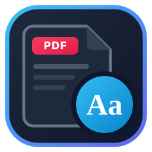

  

    <a href="../README.md">English</a> ·
    <a href="README.fr.md">Français</a> ·
    <a href="README.es.md">Español</a> ·
    <a href="README.de.md">Deutsch</a> ·
    <a href="README.it.md">Italiano</a> ·
    <strong>Português</strong> ·
    <a href="README.nl.md">Nederlands</a> ·
    <a href="README.pl.md">Polski</a> ·
    <a href="README.ru.md">Русский</a>
  

  

  <h1>PDF Fonts Detector</h1>

  

    <strong>Detete todas as fontes de qualquer PDF, verifique as já instaladas no seu PC e baixe, extraia ou instale as fontes ausentes em um clique.</strong>
  

  

    
    
  

---

## Visão geral

**PDF Fonts Detector** é um aplicativo nativo, rápido e **100% autônomo** escrito em Rust (`egui` / `eframe`) para **Windows** e **Linux**. Arraste um ou mais arquivos PDF para ver imediatamente quais fontes estão instaladas, baixar fontes gratuitas (Google Fonts, Font Squirrel, repositórios livres), extrair fontes completas incorporadas no PDF e instalá-las sem privilégios de administrador.

---

## Capturas de tela

  

---

## Recursos principais

- **Executáveis 100% autônomos**: um único binário nativo (~7–12 MB), sem Python, Qt, WebView, OpenSSL ou GTK3.
- **Inspeção profunda de PDF**: páginas, `/Resources` herdados, `CIDFonts` e `Form XObjects`, remoção de prefixos de subconjunto (`ABCDEF+Roboto-Bold` → `Roboto Bold`) e aliases PostScript.
- **Verificação precisa no PC**: leitura das tabelas internas OpenType/TrueType no **Windows** e **Linux**.
- **Downloads gratuitos sem chave API**: **Google Fonts**, **Font Squirrel** e espelhos open-source (Liberation, DejaVu, Cascadia).
- **Extração de fontes incorporadas**: ativa «Extrair do PDF» sempre que uma fonte completa está incorporada no documento.
- **Instalação sem administrador**: instalação na sessão do usuário no Windows e Linux.
- **15 idiomas integrados**: deteção automática do idioma do sistema e troca instantânea.

---

## Download

👉 **[Baixar a última versão](https://github.com/furcy75/PDF_Fonts_Detector/releases/latest)**

- **Windows (x64)**: baixe e execute `PDF-Fonts-Detector-Windows-x64.exe`.
- **Linux (x86_64)**: baixe `PDF-Fonts-Detector-Linux-x86_64` ou `PDF-Fonts-Detector-Linux-x86_64.tar.gz`.

---

## Apoie o projeto

  

---

## Licença

Licença **MIT**. Veja [LICENSE](../LICENSE).
